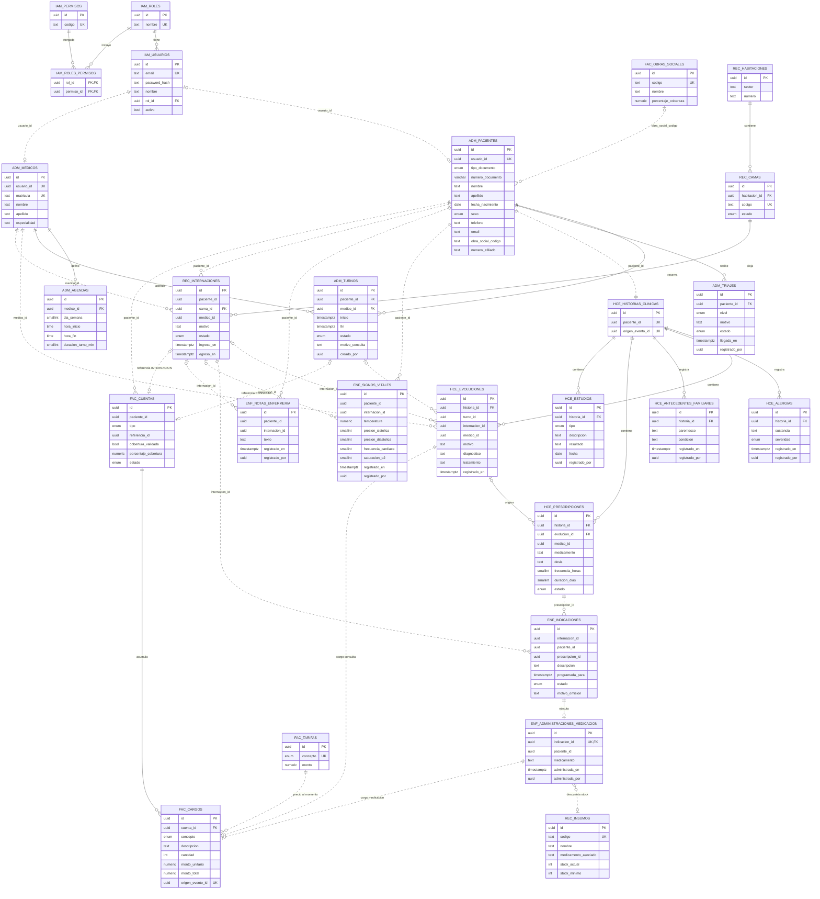

# MODELO DE DATOS — Hospital Information System (HIS)

**Complementa a:** `ROADMAP.md` · **Fecha:** 2026-10-23 · **Estado:** propuesta para aprobar en Fase 0/1

Cómo se persiste el modelo de cada módulo: tablas, columnas, claves e índices, el DER completo y el `schema.prisma`. Las entidades de dominio no son estas tablas: el repositorio de cada módulo mapea entre ambas.

---

## 1. Convenciones

- PostgreSQL con **un schema por módulo** (`iam`, `admision`, `hce`, `enfermeria`, `recursos`, `facturacion`). En Prisma es una línea (`@@schema`).
- **Sin claves foráneas entre schemas.** Cuando un módulo apunta a otro guarda el `uuid` como referencia lógica (por ejemplo `hce.historias_clinicas.paciente_id`). Así los módulos siguen independientes. Dentro de un schema las FKs son normales.
- Nombres en `snake_case` y en español. Clave primaria `id uuid` generada por la aplicación.
- Fechas `timestamptz`. Dinero `numeric(12,2)`. Enums nativos de Postgres.
- `created_at` en todas las tablas; `updated_at` solo en las que se modifican.
- **Tablas inmutables** (sin `UPDATE` ni `DELETE` desde la aplicación): `hce.evoluciones`, `hce.antecedentes_familiares`, `enfermeria.signos_vitales`, `enfermeria.administraciones_medicacion`, `enfermeria.notas_enfermeria`. Se garantiza porque el repositorio no expone esos métodos.
- Toda tabla que se crea **a partir de un evento** guarda `origen_evento_id uuid UNIQUE` para no duplicar si el evento llega dos veces.
- Toda columna `*_por` es el `id` del usuario que hizo la acción (sale del JWT).

---

## 2. Tablas por módulo

### 2.1 Schema `iam` (4 tablas)

**usuarios**

| Columna                 | Tipo        | Nota                                       |
| ----------------------- | ----------- | ------------------------------------------ |
| id                      | uuid        | PK                                         |
| email                   | text        | UNIQUE; el dominio lo guarda en minúsculas |
| password_hash           | text        | argon2 o bcrypt                            |
| nombre                  | text        |                                            |
| rol_id                  | uuid        | FK → roles                                 |
| activo                  | boolean     | default true                               |
| created_at / updated_at | timestamptz |                                            |

**roles**

| Columna | Tipo | Nota                                                                        |
| ------- | ---- | --------------------------------------------------------------------------- |
| id      | uuid | PK                                                                          |
| nombre  | text | UNIQUE: `ADMINISTRADOR`, `MEDICO`, `ENFERMERO`, `RECEPCIONISTA`, `PACIENTE` |

**permisos**

| Columna | Tipo | Nota                                                            |
| ------- | ---- | --------------------------------------------------------------- |
| id      | uuid | PK                                                              |
| codigo  | text | UNIQUE, formato `modulo:accion` (`turnos:reservar`, `hce:leer`) |

**roles_permisos**

| Columna    | Tipo | Nota                        |
| ---------- | ---- | --------------------------- |
| rol_id     | uuid | FK → roles, PK compuesta    |
| permiso_id | uuid | FK → permisos, PK compuesta |

### 2.2 Schema `admision` (5 tablas)

**pacientes**

| Columna                 | Tipo        | Nota                                                           |
| ----------------------- | ----------- | -------------------------------------------------------------- |
| id                      | uuid        | PK                                                             |
| usuario_id              | uuid        | UNIQUE, nullable; ref lógica → `iam.usuarios` (si tiene login) |
| tipo_documento          | enum        | `DNI`, `PASAPORTE`, `OTRO`                                     |
| numero_documento        | varchar(20) | UNIQUE junto con tipo_documento                                |
| nombre / apellido       | text        | índice en apellido                                             |
| fecha_nacimiento        | date        |                                                                |
| sexo                    | enum        | `F`, `M`, `X`                                                  |
| telefono / email        | text        | nullable                                                       |
| obra_social_codigo      | text        | nullable; ref lógica → `facturacion.obras_sociales.codigo`     |
| numero_afiliado         | text        | nullable                                                       |
| created_at / updated_at | timestamptz |                                                                |

**medicos**

| Columna           | Tipo        | Nota                                |
| ----------------- | ----------- | ----------------------------------- |
| id                | uuid        | PK                                  |
| usuario_id        | uuid        | UNIQUE; ref lógica → `iam.usuarios` |
| matricula         | text        | UNIQUE                              |
| nombre / apellido | text        |                                     |
| especialidad      | text        |                                     |
| created_at        | timestamptz |                                     |

**agendas** (franja semanal del médico)

| Columna                | Tipo     | Nota                 |
| ---------------------- | -------- | -------------------- |
| id                     | uuid     | PK                   |
| medico_id              | uuid     | FK → medicos         |
| dia_semana             | smallint | 0 domingo … 6 sábado |
| hora_inicio / hora_fin | time     | fin > inicio         |
| duracion_turno_min     | smallint |                      |

**turnos**

| Columna                 | Tipo        | Nota                                 |
| ----------------------- | ----------- | ------------------------------------ |
| id                      | uuid        | PK                                   |
| paciente_id             | uuid        | FK → pacientes                       |
| medico_id               | uuid        | FK → medicos                         |
| inicio / fin            | timestamptz |                                      |
| estado                  | enum        | `RESERVADO`, `CANCELADO`, `ATENDIDO` |
| motivo_consulta         | text        | nullable                             |
| creado_por              | uuid        |                                      |
| created_at / updated_at | timestamptz |                                      |

Índices: `(medico_id, inicio)`, `(paciente_id, inicio)`. Unicidad: un médico no tiene dos turnos reservados a la misma hora (índice único parcial, sección 5).

**triajes**

| Columna        | Tipo        | Nota                                                                                 |
| -------------- | ----------- | ------------------------------------------------------------------------------------ |
| id             | uuid        | PK                                                                                   |
| paciente_id    | uuid        | FK → pacientes                                                                       |
| nivel          | enum        | `ROJO`, `NARANJA`, `AMARILLO`, `VERDE`, `AZUL` (declarado en ese orden para ordenar) |
| motivo         | text        |                                                                                      |
| estado         | enum        | `EN_ESPERA`, `ATENDIDO`                                                              |
| llegada_en     | timestamptz |                                                                                      |
| registrado_por | uuid        |                                                                                      |

Índice de la cola: `(estado, nivel, llegada_en)`.

### 2.3 Schema `hce` (6 tablas)

**historias_clinicas**

| Columna          | Tipo        | Nota                                      |
| ---------------- | ----------- | ----------------------------------------- |
| id               | uuid        | PK                                        |
| paciente_id      | uuid        | UNIQUE; ref lógica → `admision.pacientes` |
| origen_evento_id | uuid        | UNIQUE (evento `PacienteRegistrado`)      |
| created_at       | timestamptz |                                           |

**evoluciones** (inmutable)

| Columna        | Tipo        | Nota                                            |
| -------------- | ----------- | ----------------------------------------------- |
| id             | uuid        | PK                                              |
| historia_id    | uuid        | FK → historias_clinicas                         |
| turno_id       | uuid        | nullable; ref lógica → `admision.turnos`        |
| internacion_id | uuid        | nullable; ref lógica → `recursos.internaciones` |
| medico_id      | uuid        | ref lógica → `admision.medicos`                 |
| motivo         | text        |                                                 |
| diagnostico    | text        |                                                 |
| tratamiento    | text        | nullable                                        |
| registrado_en  | timestamptz | hora del servidor                               |

Índice: `(historia_id, registrado_en desc)`.

**alergias**

| Columna                        | Tipo               | Nota                         |
| ------------------------------ | ------------------ | ---------------------------- |
| id                             | uuid               | PK                           |
| historia_id                    | uuid               | FK                           |
| sustancia                      | text               | UNIQUE junto con historia_id |
| severidad                      | enum               | `LEVE`, `MODERADA`, `GRAVE`  |
| registrado_en / registrado_por | timestamptz / uuid |                              |

**antecedentes_familiares** (inmutable)

| Columna                        | Tipo               | Nota |
| ------------------------------ | ------------------ | ---- |
| id                             | uuid               | PK   |
| historia_id                    | uuid               | FK   |
| parentesco                     | text               |      |
| condicion                      | text               |      |
| registrado_en / registrado_por | timestamptz / uuid |      |

**prescripciones**

| Columna                 | Tipo        | Nota                                 |
| ----------------------- | ----------- | ------------------------------------ |
| id                      | uuid        | PK                                   |
| historia_id             | uuid        | FK                                   |
| evolucion_id            | uuid        | FK → evoluciones, nullable           |
| medico_id               | uuid        |                                      |
| medicamento             | text        |                                      |
| dosis                   | text        | ej. "500 mg"                         |
| frecuencia_horas        | smallint    | > 0                                  |
| duracion_dias           | smallint    | > 0                                  |
| estado                  | enum        | `ACTIVA`, `SUSPENDIDA`, `FINALIZADA` |
| created_at / updated_at | timestamptz |                                      |

**estudios**

| Columna        | Tipo        | Nota                            |
| -------------- | ----------- | ------------------------------- |
| id             | uuid        | PK                              |
| historia_id    | uuid        | FK                              |
| tipo           | enum        | `LABORATORIO`, `IMAGEN`, `OTRO` |
| descripcion    | text        |                                 |
| resultado      | text        | nullable                        |
| fecha          | date        |                                 |
| registrado_por | uuid        |                                 |
| created_at     | timestamptz |                                 |

### 2.4 Schema `enfermeria` (4 tablas)

**indicaciones**

| Columna                 | Tipo        | Nota                                  |
| ----------------------- | ----------- | ------------------------------------- |
| id                      | uuid        | PK                                    |
| internacion_id          | uuid        | ref lógica → `recursos.internaciones` |
| paciente_id             | uuid        | ref lógica                            |
| prescripcion_id         | uuid        | ref lógica → `hce.prescripciones`     |
| descripcion             | text        | "Amoxicilina 500 mg"                  |
| programada_para         | timestamptz |                                       |
| estado                  | enum        | `PENDIENTE`, `EJECUTADA`, `OMITIDA`   |
| motivo_omision          | text        | nullable                              |
| created_at / updated_at | timestamptz |                                       |

Unicidad: `(prescripcion_id, programada_para)` para que el evento no duplique indicaciones. Índice `(internacion_id, programada_para)`.

**signos_vitales** (inmutable)

| Columna                                | Tipo               | Nota       |
| -------------------------------------- | ------------------ | ---------- |
| id                                     | uuid               | PK         |
| paciente_id                            | uuid               | ref lógica |
| internacion_id                         | uuid               | nullable   |
| temperatura                            | numeric(4,1)       | 30–45      |
| presion_sistolica / presion_diastolica | smallint           |            |
| frecuencia_cardiaca                    | smallint           |            |
| saturacion_o2                          | smallint           | 50–100     |
| registrado_en / registrado_por         | timestamptz / uuid |            |

**administraciones_medicacion** (inmutable)

| Columna                            | Tipo               | Nota                                                                      |
| ---------------------------------- | ------------------ | ------------------------------------------------------------------------- |
| id                                 | uuid               | PK                                                                        |
| indicacion_id                      | uuid               | FK → indicaciones, **UNIQUE** (una indicación se administra una sola vez) |
| paciente_id                        | uuid               |                                                                           |
| medicamento                        | text               | copia de lo administrado                                                  |
| administrada_en / administrada_por | timestamptz / uuid |                                                                           |

**notas_enfermeria** (inmutable)

| Columna                        | Tipo               | Nota     |
| ------------------------------ | ------------------ | -------- |
| id                             | uuid               | PK       |
| paciente_id                    | uuid               |          |
| internacion_id                 | uuid               | nullable |
| texto                          | text               |          |
| registrado_en / registrado_por | timestamptz / uuid |          |

### 2.5 Schema `recursos` (4 tablas)

**habitaciones**

| Columna | Tipo | Nota                               |
| ------- | ---- | ---------------------------------- |
| id      | uuid | PK                                 |
| sector  | text | `Guardia`, `Clínica Médica`, `UTI` |
| numero  | text | UNIQUE junto con sector            |

**camas**

| Columna       | Tipo        | Nota                                           |
| ------------- | ----------- | ---------------------------------------------- |
| id            | uuid        | PK                                             |
| habitacion_id | uuid        | FK → habitaciones                              |
| codigo        | text        | UNIQUE                                         |
| estado        | enum        | `LIBRE`, `OCUPADA`, `EN_LIMPIEZA`, `BLOQUEADA` |
| updated_at    | timestamptz |                                                |

**internaciones**

| Columna                 | Tipo        | Nota                              |
| ----------------------- | ----------- | --------------------------------- |
| id                      | uuid        | PK                                |
| paciente_id             | uuid        | ref lógica → `admision.pacientes` |
| cama_id                 | uuid        | FK → camas                        |
| medico_id               | uuid        | ref lógica                        |
| motivo                  | text        |                                   |
| estado                  | enum        | `ACTIVA`, `ALTA`                  |
| ingreso_en              | timestamptz |                                   |
| egreso_en               | timestamptz | nullable                          |
| created_at / updated_at | timestamptz |                                   |

Unicidad: un paciente tiene como máximo una internación `ACTIVA`; una cama tiene como máximo una internación `ACTIVA` (índices únicos parciales, sección 5).

**insumos**

| Columna              | Tipo        | Nota                                    |
| -------------------- | ----------- | --------------------------------------- |
| id                   | uuid        | PK                                      |
| codigo               | text        | UNIQUE                                  |
| nombre               | text        |                                         |
| medicamento_asociado | text        | nullable; para descontar al administrar |
| stock_actual         | int         | >= 0                                    |
| stock_minimo         | int         |                                         |
| updated_at           | timestamptz |                                         |

### 2.6 Schema `facturacion` (4 tablas)

**obras_sociales**

| Columna              | Tipo         | Nota                                  |
| -------------------- | ------------ | ------------------------------------- |
| id                   | uuid         | PK                                    |
| codigo               | text         | UNIQUE (`PARTICULAR`, `OSDE`, `PAMI`) |
| nombre               | text         |                                       |
| porcentaje_cobertura | numeric(5,2) | 0–100                                 |

**tarifas**

| Columna  | Tipo          | Nota                                         |
| -------- | ------------- | -------------------------------------------- |
| id       | uuid          | PK                                           |
| concepto | enum          | `CONSULTA`, `MEDICACION`, `DIA_CAMA`; UNIQUE |
| monto    | numeric(12,2) |                                              |

**cuentas** (una por consulta o por internación)

| Columna                 | Tipo         | Nota                                             |
| ----------------------- | ------------ | ------------------------------------------------ |
| id                      | uuid         | PK                                               |
| paciente_id             | uuid         | ref lógica                                       |
| tipo                    | enum         | `CONSULTA`, `INTERNACION`                        |
| referencia_id           | uuid         | turno_id o internacion_id; UNIQUE junto con tipo |
| cobertura_validada      | boolean      | default false                                    |
| porcentaje_cobertura    | numeric(5,2) | nullable                                         |
| estado                  | enum         | `ABIERTA`, `CERRADA`                             |
| created_at / updated_at | timestamptz  |                                                  |

**cargos**

| Columna          | Tipo          | Nota                                 |
| ---------------- | ------------- | ------------------------------------ |
| id               | uuid          | PK                                   |
| cuenta_id        | uuid          | FK → cuentas                         |
| concepto         | enum          | `CONSULTA`, `MEDICACION`, `DIA_CAMA` |
| descripcion      | text          |                                      |
| cantidad         | int           | > 0                                  |
| monto_unitario   | numeric(12,2) | copia de la tarifa en ese momento    |
| monto_total      | numeric(12,2) | cantidad × unitario                  |
| origen_evento_id | uuid          | UNIQUE (idempotencia)                |
| created_at       | timestamptz   |                                      |

Índice `(cuenta_id)` y `(concepto, created_at)` para el reporte.

**Total: 27 tablas.**

---

## 3. Referencias lógicas entre módulos

| Columna                                                        | Apunta a                     | Quién garantiza que exista               |
| -------------------------------------------------------------- | ---------------------------- | ---------------------------------------- |
| `admision.pacientes.usuario_id`, `admision.medicos.usuario_id` | `iam.usuarios`               | el caso de uso de alta valida contra IAM |
| `admision.pacientes.obra_social_codigo`                        | `facturacion.obras_sociales` | lista fija por seed                      |
| `hce.historias_clinicas.paciente_id`                           | `admision.pacientes`         | evento `PacienteRegistrado`              |
| `hce.evoluciones.turno_id / internacion_id / medico_id`        | Admisión / Recursos          | vienen del request validado              |
| `enfermeria.indicaciones.prescripcion_id`                      | `hce.prescripciones`         | evento `PrescripcionCreada`              |
| `enfermeria.indicaciones.internacion_id`                       | `recursos.internaciones`     | evento `PacienteInternado`               |
| `facturacion.cuentas.referencia_id`                            | turno o internación          | eventos de HCE y Recursos                |

---

## 4. DER completo

Notación pata de gallo. `||` exactamente uno · `o|` cero o uno · `o{` cero o muchos. Línea continua = FK real. Línea punteada = referencia lógica entre módulos. `PK` primaria, `FK` foránea, `UK` única.

Para verlo dibujado: vista previa de Markdown en VS Code (`Ctrl+Shift+V`), GitHub, o pegar el bloque en https://mermaid.live y exportar a SVG/PNG.



---

## 5. Restricciones que van en SQL manual

Prisma no declara índices únicos parciales ni `CHECK`. Ya están al final de la migración inicial (`apps/api/prisma/migrations/20261023000000_init/migration.sql`). Si se agregan nuevas, se editan en la migración generada con `prisma migrate dev --create-only`.

```sql
-- Un médico no tiene dos turnos reservados a la misma hora
CREATE UNIQUE INDEX turnos_medico_inicio_reservado_uq
  ON admision.turnos (medico_id, inicio) WHERE estado = 'RESERVADO';

-- Un paciente tiene una sola internación activa; una cama tiene una sola internación activa
CREATE UNIQUE INDEX internaciones_paciente_activa_uq
  ON recursos.internaciones (paciente_id) WHERE estado = 'ACTIVA';
CREATE UNIQUE INDEX internaciones_cama_activa_uq
  ON recursos.internaciones (cama_id) WHERE estado = 'ACTIVA';

-- Rangos básicos
ALTER TABLE admision.agendas ADD CONSTRAINT agendas_horas CHECK (hora_fin > hora_inicio);
ALTER TABLE admision.turnos  ADD CONSTRAINT turnos_rango CHECK (fin > inicio);
ALTER TABLE recursos.insumos ADD CONSTRAINT insumos_stock_no_negativo CHECK (stock_actual >= 0);
ALTER TABLE facturacion.cargos ADD CONSTRAINT cargos_cantidad_positiva CHECK (cantidad > 0);
ALTER TABLE enfermeria.signos_vitales
  ADD CONSTRAINT sv_temperatura CHECK (temperatura IS NULL OR temperatura BETWEEN 30 AND 45),
  ADD CONSTRAINT sv_spo2 CHECK (saturacion_o2 IS NULL OR saturacion_o2 BETWEEN 50 AND 100);
```

---

## 6. `schema.prisma`

Archivo único `apps/api/prisma/schema.prisma` (ya creado en el repo; esta es la copia de referencia). Cada módulo edita solo su sección. Con Prisma 6.19 `multiSchema` ya es estable y no necesita `previewFeatures`.

```prisma
generator client {
  provider = "prisma-client-js"
}

datasource db {
  provider = "postgresql"
  url      = env("DATABASE_URL")
  schemas  = ["iam", "admision", "hce", "enfermeria", "recursos", "facturacion"]
}

// ============================ IAM ============================

model Usuario {
  id           String   @id @db.Uuid
  email        String   @unique
  passwordHash String   @map("password_hash")
  nombre       String
  rolId        String   @map("rol_id") @db.Uuid
  activo       Boolean  @default(true)
  createdAt    DateTime @default(now()) @map("created_at") @db.Timestamptz
  updatedAt    DateTime @updatedAt @map("updated_at") @db.Timestamptz
  rol          Rol      @relation(fields: [rolId], references: [id])

  @@map("usuarios")
  @@schema("iam")
}

model Rol {
  id       String       @id @db.Uuid
  nombre   String       @unique
  usuarios Usuario[]
  permisos RolPermiso[]

  @@map("roles")
  @@schema("iam")
}

model Permiso {
  id     String       @id @db.Uuid
  codigo String       @unique
  roles  RolPermiso[]

  @@map("permisos")
  @@schema("iam")
}

model RolPermiso {
  rolId     String  @map("rol_id") @db.Uuid
  permisoId String  @map("permiso_id") @db.Uuid
  rol       Rol     @relation(fields: [rolId], references: [id])
  permiso   Permiso @relation(fields: [permisoId], references: [id])

  @@id([rolId, permisoId])
  @@map("roles_permisos")
  @@schema("iam")
}

// ============================ ADMISION ============================

enum TipoDocumento {
  DNI
  PASAPORTE
  OTRO
  @@schema("admision")
}

enum Sexo {
  F
  M
  X
  @@schema("admision")
}

enum EstadoTurno {
  RESERVADO
  CANCELADO
  ATENDIDO
  @@schema("admision")
}

// El orden de declaración es el orden de prioridad.
enum NivelTriaje {
  ROJO
  NARANJA
  AMARILLO
  VERDE
  AZUL
  @@schema("admision")
}

enum EstadoTriaje {
  EN_ESPERA
  ATENDIDO
  @@schema("admision")
}

model Paciente {
  id               String        @id @db.Uuid
  usuarioId        String?       @unique @map("usuario_id") @db.Uuid
  tipoDocumento    TipoDocumento @map("tipo_documento")
  numeroDocumento  String        @map("numero_documento") @db.VarChar(20)
  nombre           String
  apellido         String
  fechaNacimiento  DateTime      @map("fecha_nacimiento") @db.Date
  sexo             Sexo
  telefono         String?
  email            String?
  obraSocialCodigo String?       @map("obra_social_codigo")
  numeroAfiliado   String?       @map("numero_afiliado")
  createdAt        DateTime      @default(now()) @map("created_at") @db.Timestamptz
  updatedAt        DateTime      @updatedAt @map("updated_at") @db.Timestamptz
  turnos           Turno[]
  triajes          Triaje[]

  @@unique([tipoDocumento, numeroDocumento])
  @@index([apellido])
  @@map("pacientes")
  @@schema("admision")
}

model Medico {
  id           String   @id @db.Uuid
  usuarioId    String   @unique @map("usuario_id") @db.Uuid
  matricula    String   @unique
  nombre       String
  apellido     String
  especialidad String
  createdAt    DateTime @default(now()) @map("created_at") @db.Timestamptz
  agendas      Agenda[]
  turnos       Turno[]

  @@map("medicos")
  @@schema("admision")
}

model Agenda {
  id               String   @id @db.Uuid
  medicoId         String   @map("medico_id") @db.Uuid
  diaSemana        Int      @map("dia_semana") @db.SmallInt
  horaInicio       DateTime @map("hora_inicio") @db.Time
  horaFin          DateTime @map("hora_fin") @db.Time
  duracionTurnoMin Int      @map("duracion_turno_min") @db.SmallInt
  medico           Medico   @relation(fields: [medicoId], references: [id])

  @@index([medicoId])
  @@map("agendas")
  @@schema("admision")
}

model Turno {
  id             String      @id @db.Uuid
  pacienteId     String      @map("paciente_id") @db.Uuid
  medicoId       String      @map("medico_id") @db.Uuid
  inicio         DateTime    @db.Timestamptz
  fin            DateTime    @db.Timestamptz
  estado         EstadoTurno @default(RESERVADO)
  motivoConsulta String?     @map("motivo_consulta")
  creadoPor      String      @map("creado_por") @db.Uuid
  createdAt      DateTime    @default(now()) @map("created_at") @db.Timestamptz
  updatedAt      DateTime    @updatedAt @map("updated_at") @db.Timestamptz
  paciente       Paciente    @relation(fields: [pacienteId], references: [id])
  medico         Medico      @relation(fields: [medicoId], references: [id])

  @@index([medicoId, inicio])
  @@index([pacienteId, inicio])
  @@map("turnos")
  @@schema("admision")
}

model Triaje {
  id            String       @id @db.Uuid
  pacienteId    String       @map("paciente_id") @db.Uuid
  nivel         NivelTriaje
  motivo        String
  estado        EstadoTriaje @default(EN_ESPERA)
  llegadaEn     DateTime     @map("llegada_en") @db.Timestamptz
  registradoPor String       @map("registrado_por") @db.Uuid
  paciente      Paciente     @relation(fields: [pacienteId], references: [id])

  @@index([estado, nivel, llegadaEn])
  @@map("triajes")
  @@schema("admision")
}

// ============================ HCE ============================

enum SeveridadAlergia {
  LEVE
  MODERADA
  GRAVE
  @@schema("hce")
}

enum EstadoPrescripcion {
  ACTIVA
  SUSPENDIDA
  FINALIZADA
  @@schema("hce")
}

enum TipoEstudio {
  LABORATORIO
  IMAGEN
  OTRO
  @@schema("hce")
}

model HistoriaClinica {
  id             String                @id @db.Uuid
  pacienteId     String                @unique @map("paciente_id") @db.Uuid
  origenEventoId String                @unique @map("origen_evento_id") @db.Uuid
  createdAt      DateTime              @default(now()) @map("created_at") @db.Timestamptz
  evoluciones    Evolucion[]
  alergias       Alergia[]
  antecedentes   AntecedenteFamiliar[]
  prescripciones Prescripcion[]
  estudios       Estudio[]

  @@map("historias_clinicas")
  @@schema("hce")
}

model Evolucion {
  id            String          @id @db.Uuid
  historiaId    String          @map("historia_id") @db.Uuid
  turnoId       String?         @map("turno_id") @db.Uuid
  internacionId String?         @map("internacion_id") @db.Uuid
  medicoId      String          @map("medico_id") @db.Uuid
  motivo        String
  diagnostico   String
  tratamiento   String?
  registradoEn  DateTime        @default(now()) @map("registrado_en") @db.Timestamptz
  historia      HistoriaClinica @relation(fields: [historiaId], references: [id])
  prescripciones Prescripcion[]

  @@index([historiaId, registradoEn(sort: Desc)])
  @@map("evoluciones")
  @@schema("hce")
}

model Alergia {
  id            String           @id @db.Uuid
  historiaId    String           @map("historia_id") @db.Uuid
  sustancia     String
  severidad     SeveridadAlergia
  registradoEn  DateTime         @default(now()) @map("registrado_en") @db.Timestamptz
  registradoPor String           @map("registrado_por") @db.Uuid
  historia      HistoriaClinica  @relation(fields: [historiaId], references: [id])

  @@unique([historiaId, sustancia])
  @@map("alergias")
  @@schema("hce")
}

model AntecedenteFamiliar {
  id            String          @id @db.Uuid
  historiaId    String          @map("historia_id") @db.Uuid
  parentesco    String
  condicion     String
  registradoEn  DateTime        @default(now()) @map("registrado_en") @db.Timestamptz
  registradoPor String          @map("registrado_por") @db.Uuid
  historia      HistoriaClinica @relation(fields: [historiaId], references: [id])

  @@index([historiaId])
  @@map("antecedentes_familiares")
  @@schema("hce")
}

model Prescripcion {
  id              String             @id @db.Uuid
  historiaId      String             @map("historia_id") @db.Uuid
  evolucionId     String?            @map("evolucion_id") @db.Uuid
  medicoId        String             @map("medico_id") @db.Uuid
  medicamento     String
  dosis           String
  frecuenciaHoras Int                @map("frecuencia_horas") @db.SmallInt
  duracionDias    Int                @map("duracion_dias") @db.SmallInt
  estado          EstadoPrescripcion @default(ACTIVA)
  createdAt       DateTime           @default(now()) @map("created_at") @db.Timestamptz
  updatedAt       DateTime           @updatedAt @map("updated_at") @db.Timestamptz
  historia        HistoriaClinica    @relation(fields: [historiaId], references: [id])
  evolucion       Evolucion?         @relation(fields: [evolucionId], references: [id])

  @@index([historiaId, estado])
  @@map("prescripciones")
  @@schema("hce")
}

model Estudio {
  id            String          @id @db.Uuid
  historiaId    String          @map("historia_id") @db.Uuid
  tipo          TipoEstudio
  descripcion   String
  resultado     String?
  fecha         DateTime        @db.Date
  registradoPor String          @map("registrado_por") @db.Uuid
  createdAt     DateTime        @default(now()) @map("created_at") @db.Timestamptz
  historia      HistoriaClinica @relation(fields: [historiaId], references: [id])

  @@index([historiaId])
  @@map("estudios")
  @@schema("hce")
}

// ============================ ENFERMERIA ============================

enum EstadoIndicacion {
  PENDIENTE
  EJECUTADA
  OMITIDA
  @@schema("enfermeria")
}

model Indicacion {
  id             String                    @id @db.Uuid
  internacionId  String                    @map("internacion_id") @db.Uuid
  pacienteId     String                    @map("paciente_id") @db.Uuid
  prescripcionId String                    @map("prescripcion_id") @db.Uuid
  descripcion    String
  programadaPara DateTime                  @map("programada_para") @db.Timestamptz
  estado         EstadoIndicacion          @default(PENDIENTE)
  motivoOmision  String?                   @map("motivo_omision")
  createdAt      DateTime                  @default(now()) @map("created_at") @db.Timestamptz
  updatedAt      DateTime                  @updatedAt @map("updated_at") @db.Timestamptz
  administracion AdministracionMedicacion?

  @@unique([prescripcionId, programadaPara])
  @@index([internacionId, programadaPara])
  @@map("indicaciones")
  @@schema("enfermeria")
}

model SignosVitales {
  id                 String   @id @db.Uuid
  pacienteId         String   @map("paciente_id") @db.Uuid
  internacionId      String?  @map("internacion_id") @db.Uuid
  temperatura        Decimal? @db.Decimal(4, 1)
  presionSistolica   Int?     @map("presion_sistolica") @db.SmallInt
  presionDiastolica  Int?     @map("presion_diastolica") @db.SmallInt
  frecuenciaCardiaca Int?     @map("frecuencia_cardiaca") @db.SmallInt
  saturacionO2       Int?     @map("saturacion_o2") @db.SmallInt
  registradoEn       DateTime @default(now()) @map("registrado_en") @db.Timestamptz
  registradoPor      String   @map("registrado_por") @db.Uuid

  @@index([pacienteId, registradoEn(sort: Desc)])
  @@map("signos_vitales")
  @@schema("enfermeria")
}

model AdministracionMedicacion {
  id              String     @id @db.Uuid
  indicacionId    String     @unique @map("indicacion_id") @db.Uuid
  pacienteId      String     @map("paciente_id") @db.Uuid
  medicamento     String
  administradaEn  DateTime   @default(now()) @map("administrada_en") @db.Timestamptz
  administradaPor String     @map("administrada_por") @db.Uuid
  indicacion      Indicacion @relation(fields: [indicacionId], references: [id])

  @@index([pacienteId])
  @@map("administraciones_medicacion")
  @@schema("enfermeria")
}

model NotaEnfermeria {
  id            String   @id @db.Uuid
  pacienteId    String   @map("paciente_id") @db.Uuid
  internacionId String?  @map("internacion_id") @db.Uuid
  texto         String
  registradoEn  DateTime @default(now()) @map("registrado_en") @db.Timestamptz
  registradoPor String   @map("registrado_por") @db.Uuid

  @@index([pacienteId, registradoEn(sort: Desc)])
  @@map("notas_enfermeria")
  @@schema("enfermeria")
}

// ============================ RECURSOS ============================

enum EstadoCama {
  LIBRE
  OCUPADA
  EN_LIMPIEZA
  BLOQUEADA
  @@schema("recursos")
}

enum EstadoInternacion {
  ACTIVA
  ALTA
  @@schema("recursos")
}

model Habitacion {
  id     String @id @db.Uuid
  sector String
  numero String
  camas  Cama[]

  @@unique([sector, numero])
  @@map("habitaciones")
  @@schema("recursos")
}

model Cama {
  id            String        @id @db.Uuid
  habitacionId  String        @map("habitacion_id") @db.Uuid
  codigo        String        @unique
  estado        EstadoCama    @default(LIBRE)
  updatedAt     DateTime      @updatedAt @map("updated_at") @db.Timestamptz
  habitacion    Habitacion    @relation(fields: [habitacionId], references: [id])
  internaciones Internacion[]

  @@index([estado])
  @@map("camas")
  @@schema("recursos")
}

model Internacion {
  id         String            @id @db.Uuid
  pacienteId String            @map("paciente_id") @db.Uuid
  camaId     String            @map("cama_id") @db.Uuid
  medicoId   String            @map("medico_id") @db.Uuid
  motivo     String
  estado     EstadoInternacion @default(ACTIVA)
  ingresoEn  DateTime          @map("ingreso_en") @db.Timestamptz
  egresoEn   DateTime?         @map("egreso_en") @db.Timestamptz
  createdAt  DateTime          @default(now()) @map("created_at") @db.Timestamptz
  updatedAt  DateTime          @updatedAt @map("updated_at") @db.Timestamptz
  cama       Cama              @relation(fields: [camaId], references: [id])

  @@index([pacienteId])
  @@index([camaId])
  @@map("internaciones")
  @@schema("recursos")
}

model Insumo {
  id                  String   @id @db.Uuid
  codigo              String   @unique
  nombre              String
  medicamentoAsociado String?  @map("medicamento_asociado")
  stockActual         Int      @map("stock_actual")
  stockMinimo         Int      @map("stock_minimo")
  updatedAt           DateTime @updatedAt @map("updated_at") @db.Timestamptz

  @@index([medicamentoAsociado])
  @@map("insumos")
  @@schema("recursos")
}

// ============================ FACTURACION ============================

enum ConceptoCargo {
  CONSULTA
  MEDICACION
  DIA_CAMA
  @@schema("facturacion")
}

enum TipoCuenta {
  CONSULTA
  INTERNACION
  @@schema("facturacion")
}

enum EstadoCuenta {
  ABIERTA
  CERRADA
  @@schema("facturacion")
}

model ObraSocial {
  id                  String  @id @db.Uuid
  codigo              String  @unique
  nombre              String
  porcentajeCobertura Decimal @map("porcentaje_cobertura") @db.Decimal(5, 2)

  @@map("obras_sociales")
  @@schema("facturacion")
}

model Tarifa {
  id       String        @id @db.Uuid
  concepto ConceptoCargo @unique
  monto    Decimal       @db.Decimal(12, 2)

  @@map("tarifas")
  @@schema("facturacion")
}

model Cuenta {
  id                  String       @id @db.Uuid
  pacienteId          String       @map("paciente_id") @db.Uuid
  tipo                TipoCuenta
  referenciaId        String       @map("referencia_id") @db.Uuid
  coberturaValidada   Boolean      @default(false) @map("cobertura_validada")
  porcentajeCobertura Decimal?     @map("porcentaje_cobertura") @db.Decimal(5, 2)
  estado              EstadoCuenta @default(ABIERTA)
  createdAt           DateTime     @default(now()) @map("created_at") @db.Timestamptz
  updatedAt           DateTime     @updatedAt @map("updated_at") @db.Timestamptz
  cargos              Cargo[]

  @@unique([tipo, referenciaId])
  @@index([pacienteId])
  @@map("cuentas")
  @@schema("facturacion")
}

model Cargo {
  id             String        @id @db.Uuid
  cuentaId       String        @map("cuenta_id") @db.Uuid
  concepto       ConceptoCargo
  descripcion    String
  cantidad       Int
  montoUnitario  Decimal       @map("monto_unitario") @db.Decimal(12, 2)
  montoTotal     Decimal       @map("monto_total") @db.Decimal(12, 2)
  origenEventoId String        @unique @map("origen_evento_id") @db.Uuid
  createdAt      DateTime      @default(now()) @map("created_at") @db.Timestamptz
  cuenta         Cuenta        @relation(fields: [cuentaId], references: [id])

  @@index([cuentaId])
  @@index([concepto, createdAt])
  @@map("cargos")
  @@schema("facturacion")
}
```

---

## 7. Seed

`apps/api/prisma/seed.ts`, idempotente:

- 5 roles con sus permisos y un administrador desde `ADMIN_EMAIL` / `ADMIN_PASSWORD`.
- 3 obras sociales (`PARTICULAR` 0 %, `OSDE` 80 %, `PAMI` 100 %) y una tarifa por concepto.
- 3 habitaciones con 2 camas cada una y 5 insumos.
- Solo en desarrollo: 10 pacientes, 2 médicos con agenda, algunos turnos.
