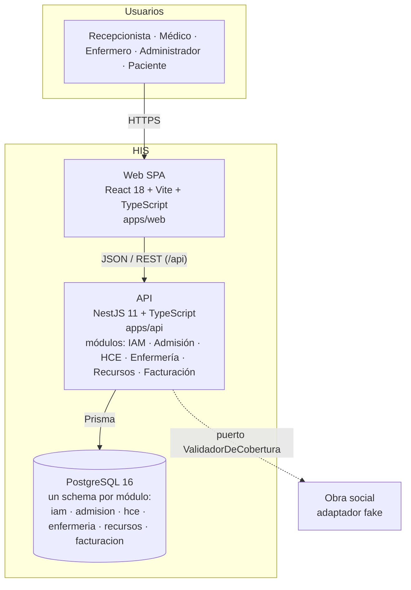
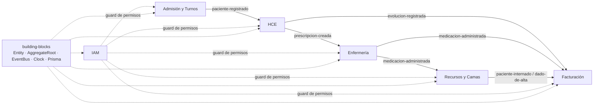

# C4 — Nivel 2: Contenedores

Las piezas desplegables del sistema y la tecnología de cada una.

## Dentro de la API

Los seis módulos corren en el mismo proceso y se comunican solo por eventos en memoria (ADR-004) o por los contratos de su carpeta `public/`.

## Nivel 3 (componentes)

La anatomía interna de cada módulo es siempre la misma y está documentada en `apps/api/src/modules/ejemplo/README.md`: `domain → application → infrastructure + api`, con `public/` como superficie hacia otros módulos. No se dibuja un diagrama por módulo (fuera de alcance, ROADMAP §10).
