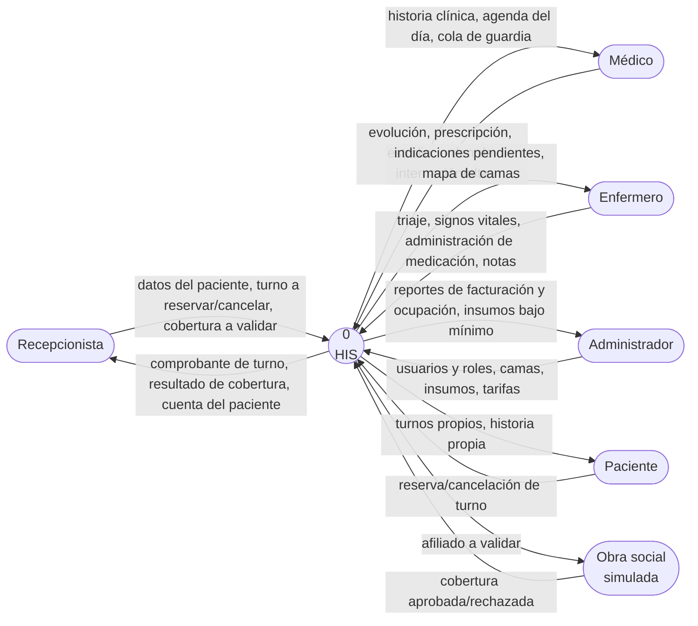

# DFD — Nivel 0 (diagrama de contexto)

Cómo entra y sale la información del sistema, visto como un único proceso.

## Almacenes de datos (nivel 1 implícito)

Cada módulo tiene su almacén, que es su schema de Postgres. Los flujos entre módulos son los eventos de `ROADMAP.md §4.4`.

| Almacén               | Schema        | Dato sensible                                                                         |
| --------------------- | ------------- | ------------------------------------------------------------------------------------- |
| D1 Usuarios           | `iam`         | hash de password                                                                      |
| D2 Pacientes y turnos | `admision`    | datos personales                                                                      |
| D3 Historia clínica   | `hce`         | **datos de salud: acceso solo por permiso `hce:leer`; el paciente solo ve la propia** |
| D4 Enfermería         | `enfermeria`  | datos de salud                                                                        |
| D5 Camas e insumos    | `recursos`    | —                                                                                     |
| D6 Cuentas y cargos   | `facturacion` | datos económicos                                                                      |
